<div align="center">



# 🇮🇳 bhailang

### Ek GenZ Hinglish programming language — scratch se, sirf plain Node.js mein.

*Code likh, `bhai bol`, aur chill kar.* 😎

<p>
  
  
  
  
</p>

[**Kya hai?**](#what-is) •
[**Quick Start**](#quick-start) •
[**Language Tour**](#language-tour) •
[**Keywords**](#keywords) •
[**Examples**](#examples) •
[**REPL**](#repl) •
[**Layout**](#project-layout) •
[**Contribute**](#contribute)

</div>

---

<div align="center">
<a id="what-is"></a>

</div>

**Bhailang** ek interpreted programming language hai jisme keywords **Hinglish** mein hain — `bhai bol`, `agar`, `warna`, `jabtak`, `kaam banao`. Isse seedhe **plain Node.js** mein bina kisi npm package ke likha gaya hai: lexer → parser → AST → interpreter, sab kuch scratch se.

```bhai
bhai ye hai naam = "Bhai";
bhai bol "Namaste", naam;
```

```text
Namaste Bhai
```

### ✨ Highlights

- 🧠 **Poora interpreter scratch se** — lexer, recursive-descent parser, AST walker
- 📦 **Zero dependencies** — `npm install` ki zaroorat hi nahi
- 🔁 **Interactive REPL** — variables aur functions line-to-line yaad rehte hain
- 🧩 **Closures, recursion, first-class functions** — sab chalta hai
- 📚 **Lists aur dicts**, negative indexing (`xs[-1]`), string repeat (`"ab" * 3`)
- 🧪 **Built-in test suite** — `node test.js`

---

<div align="center">
<a id="quick-start"></a>

</div>

> Node.js **14 ya usse naya** chahiye.

```bash
# repo clone kar
git clone https://github.com/AkkhileshCod3s/Bhailang-Hinglish.git
cd Bhailang-Hinglish

# REPL start kar
node index.js

# ya koi script chala
node index.js examples/fizzbuzz.bhai

# tests chala
node test.js
```

---

<div align="center">
<a id="language-tour"></a>

</div>

<details open>
<summary><b>1️⃣ Basics — variables aur print</b></summary>

```bhai
// comments // se shuru hote hain

bhai ye hai naam = "Bhai";          // variable declare kar
bhai ye hai x;                      // value nahi di -> khali (null)
x = 10;                             // assign kar
x += 5;                             // -=  *=  /=  %= bhi chalta hai
bhai bol "Namaste", naam, x;        // print (multiple values space se judti hain)
```

</details>

<details>
<summary><b>2️⃣ Values — data types</b></summary>

| Kind          | Examples                                                           |
| ------------- | ------------------------------------------------------------------ |
| number        | `42`, `3.14`, `-7`                                                 |
| string        | `"hello"`, `'hi'`, `"line\nbreak"`                                 |
| bool / null   | `sahi`, `galat`, `khali`                                           |
| list          | `[1, "a", sahi]`, `xs[0]`, `xs[-1]`, `xs[1] = 5`                   |
| dict          | `{"naam": "bhai", "umar": 20}`, `d["naam"]`, `d["city"] = "Delhi"` |
| function      | `kaam banao ...` (neeche dekh)                                     |

</details>

<details>
<summary><b>3️⃣ Operators — loosest se tightest tak</b></summary>

| Operators                   | Matlab                                              |
| --------------------------- | --------------------------------------------------- |
| `ya`                        | or                                                  |
| `aur`                       | and                                                 |
| `nahi`                      | not                                                 |
| `==` `!=` `<` `>` `<=` `>=` | comparison                                          |
| `+` `-`                     | add / subtract (`+` strings aur lists bhi jodta hai) |
| `*` `/` `%`                 | multiply / divide / remainder (`"ab" * 3` repeat karta hai) |
| `-x`                        | negative                                            |
| `**`                        | power (right associative)                           |
| `f(x)` `xs[i]`              | call / index                                        |

> 💡 `aur` aur `ya` **short-circuit** karte hain aur Python ki tarah ek operand return karte hain.
> Khali values (`0`, `""`, `[]`, `{}`, `khali`, `galat`) **false** maani jaati hain.

</details>

<details>
<summary><b>4️⃣ Conditions — agar / warna</b></summary>

```bhai
agar x > 10 {
  bhai bol "bada";
} warna agar x > 5 {
  bhai bol "medium";
} warna {
  bhai bol "chhota";
}
```

</details>

<details>
<summary><b>5️⃣ Loops — jabtak / har</b></summary>

```bhai
jabtak i < 5 { i += 1; }                // while loop

har i mein range(5) { bhai bol i; }     // for loop: list, string, dict keys ya range()

har i mein range(10) {
  agar i == 3 { aage badh; }            // agle round pe jao (continue)
  agar i == 7 { ruk; }                  // loop rok do (break)
  bhai bol i;
}
```

</details>

<details>
<summary><b>6️⃣ Functions — kaam banao</b></summary>

```bhai
kaam banao add(a, b) {
  wapas do a + b;
}
bhai bol add(2, 3);
```

Functions **khud ko call** kar sakte hain (recursion), **values ki tarah pass** ho sakte hain, aur apne aas-paas ke variables ko **yaad rakhte hain (closures)**. `wapas do;` bina value ke `khali` return karta hai.

</details>

<details>
<summary><b>7️⃣ Input — bhai sun</b></summary>

```bhai
bhai ye hai naam = bhai sun("Tera naam? ");   // hamesha string milti hai
bhai ye hai umar = int(bhai sun("Umar? "));
```

</details>

<details>
<summary><b>8️⃣ Built-in functions</b></summary>

| Group          | Functions                                                                                              |
| -------------- | ------------------------------------------------------------------------------------------------------ |
| basics         | `len` `range` `str` `int` `float` `type`                                                               |
| math           | `abs` `min` `max` `sum` `round` `floor` `ceil` `sqrt` `randint(a, b)` `random()` aur constant `pi`      |
| lists          | `sorted` `reverse` `push(list, x)` `pop(list)` / `pop(list, i)`                                        |
| dicts / search | `keys` `values` `has(container, x)` (list item, substring ya dict key)                                 |
| strings        | `upper` `lower` `strip` `split(s)` / `split(s, sep)` `join(list, sep)` `replace(s, old, new)`          |

</details>

<details>
<summary><b>9️⃣ Scoping</b></summary>

`{ }` blocks (`agar`, loops, functions) ka apna **scope** hota hai. Andar declare kiye variables bahar nahi dikhte, lekin bahar wale variable ko assign karne (`x = 2;`) se wo **bahar wala hi change** hota hai.

</details>

---

<div align="center">
<a id="keywords"></a>

</div>

| Bhailang      | Matlab (English)        | Bhailang   | Matlab (English)  |
| ------------- | ----------------------- | ---------- | ----------------- |
| `bhai ye hai` | `let` / `var`           | `jabtak`   | `while`           |
| `bhai bol`    | `print`                 | `har` `mein` | `for ... in`    |
| `bhai sun`    | `input`                 | `ruk`      | `break`           |
| `kaam banao`  | `function`              | `aage badh`| `continue`        |
| `wapas do`    | `return`                | `sahi`     | `true`            |
| `agar`        | `if`                    | `galat`    | `false`           |
| `warna`       | `else`                  | `khali`    | `null`            |
| `aur`         | `and`                   | `ya`       | `or`              |
| `nahi`        | `not`                   | `nikal`    | REPL se bahar (exit) |

---

<div align="center">
<a id="examples"></a>

</div>

### 👋 Hello Bhai

```bhai
bhai ye hai naam = "Bhai";
bhai bol "Namaste", naam;
```

### 🔢 FizzBuzz

```bhai
har n mein range(15) {
  bhai ye hai i = n + 1;
  agar i % 15 == 0 { bhai bol "FizzBuzz"; }
  warna agar i % 3 == 0 { bhai bol "Fizz"; }
  warna agar i % 5 == 0 { bhai bol "Buzz"; }
  warna { bhai bol i; }
}
```

### 🧮 Recursion — factorial

```bhai
kaam banao fact(n) {
  agar n <= 1 { wapas do 1; }
  wapas do n * fact(n - 1);
}
bhai bol "5! =", fact(5);
```

Aur bhi sample programs `examples/` folder mein hain:

| File                      | Kya karta hai                |
| ------------------------- | ---------------------------- |
| `examples/fizzbuzz.bhai`  | Classic FizzBuzz             |
| `examples/functions.bhai` | Functions aur closures       |
| `examples/lists_and_dicts.bhai` | Lists aur dicts ka khel |
| `examples/calculator.bhai`| Chhota sa calculator         |
| `examples/guess.bhai`     | Number guess karne ka game   |
| `examples/demo.bhai`      | Full demo                    |

---

<div align="center">
<a id="repl"></a>

</div>

```bash
node index.js
```

- Variables aur functions **line-to-line memory mein rehte hain**.
- Sirf `2 + 3` likhne par result **apne aap print** hota hai.
- Multi-line code ke liye `{` kholo aur typing jaari rakho; block band hone ke baad **khali line pe Enter** dabao to code chal jayega. `agar` ko aage badhane ke liye `warna` seedha closing `}` wali line ke baad likho.
- `nikal` ya `exit` likh ke bahar aa jao.

---

<div align="center">
<a id="project-layout"></a>

</div>

```text
Bhailang-Hinglish/
├── index.js            # CLI: file runner + REPL
├── test.js             # test suite (node test.js)
├── package.json
├── examples/           # sample .bhai programs
└── src/
    ├── lexer.js        # source text -> tokens (multi-word keywords, strings, operators)
    ├── parser.js       # recursive descent parser, AST banata hai
    ├── environment.js  # variable memory / nested scopes
    ├── interpreter.js  # AST walk karke code chalata hai
    ├── values.js       # runtime values, printing, equality
    ├── builtins.js     # built-in function library
    └── io.js           # console input / output
```

### ⚙️ Kaise chalta hai andar se?

```text
 source code ──► Lexer ──► Parser ──► AST ──► Interpreter ──► output
   (.bhai)      tokens    (recursive           (Environment +
                           descent)             builtins)
```

---

<div align="center">
<a id="contribute"></a>

</div>

Idea hai? Bug mila? Naya keyword chahiye? Seedha **issue** kholo ya **pull request** bhejo.

1. Repo ko **fork** kar
2. Naya branch bana: `git checkout -b feature/mera-idea`
3. Change kar aur `node test.js` chala ke dekh ki sab pass ho raha hai
4. Commit + push kar, phir **PR** khol de

---

<div align="center">

**Banaya hai [@AkkhileshCod3s](https://github.com/AkkhileshCod3s) ne** ❤️

Agar pasand aaya to ek ⭐ de de, **Bhai** khush ho jayega!

</div>